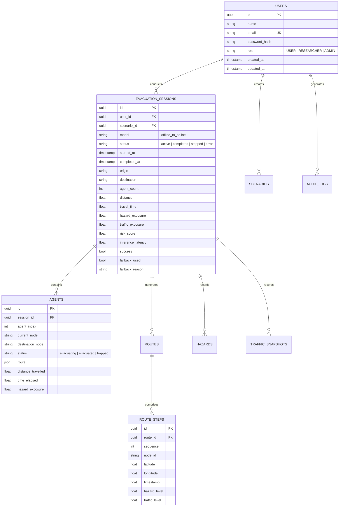

# Database Architecture & Entity Specifications

## Dual Resilient Storage Strategy

The platform features an enterprise storage layer with dual-engine resilience:
1. **Primary Engine**: **PostgreSQL 16** via `postgresql+psycopg2`.
2. **Resilient Local Fallback Engine**: **SQLite 3** (`evacuation.db`) via native Python standard library.

If PostgreSQL is temporarily offline or Docker is unstarted during local evaluation, `backend/app/database/session.py` transparently shifts to SQLite without raising unhandled exceptions or disrupting running simulations.

---

## Entity Relational Schema

