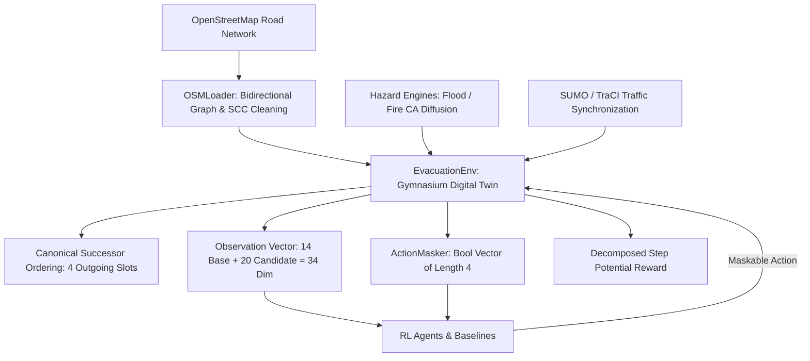

# Comprehensive Project Audit: Reinforcement-Learning-Based Multi-Hazard Evacuation Routing

**Project**: Adaptive RL Traffic Digital Twin for Evacuation Route Optimization  
**Date**: September 2026  
**Document**: `docs/HYBRID_MODEL_AUDIT.md`  
**Status**: Comprehensive Baseline & Architecture Audit Completed  

---

## 1. Executive Summary & Audit Scope

This audit provides an exhaustive forensic inspection of the existing reinforcement learning evacuation routing framework prior to architectural extension. The framework simulates dynamic urban disaster evacuation under multi-hazard conditions (flash floods and wildland/urban interface fires) coupled with microscopic traffic dynamics via SUMO (Simulation of Urban MObility) and an internal digital twin state estimator.

The audit evaluates:
1. Environment dynamics, state representations, action spaces, and reward formulations.
2. Consistency of the 34-dimensional observation vector across all agents.
3. Validity and safety enforcement of action masking across all graph transitions.
4. Separation and statistical independence of training, validation, and test scenario sets.
5. Reproducibility of multi-seed random number generation.
6. Baseline results preservation across 84-node, 336-node, George Town, and OMR networks.
7. Architectural integration points for five hybrid RL architectures.

---

## 2. Current Architecture & Pipeline Overview

### 2.1 Core Environment Implementation (`src/environment/evacuation_env.py`)
- **Gymnasium Compliance**: Subclasses `gym.Env`, implements `reset()`, `step()`, `action_masks()`, and `close()`.
- **Road Network Representation**: `networkx.DiGraph` with UTM coordinates (`x`, `y`), edge `length`, and speed limits.
- **Topological Invariant**: Canonical successor ordering ranks outgoing neighbors by remaining road network shortest-path distance to the destination:
  - Slot 0: Primary candidate (shortest path to destination).
  - Slot 1: First detour candidate (2nd shortest path).
  - Slot 2: Second detour candidate (3rd shortest path).
  - Slot 3: Third detour candidate (4th shortest path).
- **Action Space**: `gym.spaces.Discrete(4)` representing choice among the 4 canonical slots.
- **Microscopic Traffic Model**: Coupled with SUMO via TraCI when enabled (`use_traci=True`), with graceful fallback to an internal dynamic queuing and congestion estimator.
- **Hazard Dynamics**: Two specialized cellular automata engines:
  - `FloodEngine`: Elevation sensitivity, diffusion rate, degradation threshold ($0.35$), closure threshold ($0.70$).
  - `FireEngine`: Wind direction, wind speed, vegetation density, degradation threshold ($0.30$), closure threshold ($0.65$).

---

## 3. Observation Space & Action Masking Audit

### 3.1 Observation Consistency (34 Dimensions)
The observation space is defined as `Box(low=0.0, high=1.0, shape=(34,), dtype=np.float32)`. The 34 features are composed of:
- **Base Spatial & Global Features (Indices 0–13, 14 dims)**:
  1. `curr_x_norm`: Normalized agent X-coordinate $[0, 1]$.
  2. `curr_y_norm`: Normalized agent Y-coordinate $[0, 1]$.
  3. `dest_x_norm`: Normalized destination X-coordinate $[0, 1]$.
  4. `dest_y_norm`: Normalized destination Y-coordinate $[0, 1]$.
  5. `rem_dist_norm`: Normalized road network shortest path distance to destination $[0, 1]$.
  6. `curr_haz`: Live hazard intensity at current node $[0, 1]$.
  7. `mean_out_haz`: Average hazard intensity across all outgoing edges $[0, 1]$.
  8. `frac_closed`: Fraction of outgoing edges completely blocked/closed $[0, 1]$.
  9. `frac_degraded`: Fraction of outgoing edges speed-degraded $[0, 1]$.
  10. `congestion`: Local traffic density / occupancy $[0, 1]$.
  11. `avg_speed`: Normalized local speed $[0, 1]$.
  12. `queue_len`: Normalized local halting vehicle queue $[0, 1]$.
  13. `time_norm`: Step counter normalized by `max_episode_steps` $[0, 1]$.
  14. `deg_norm`: Out-degree normalized by `max_neighbors` $[0, 1]$.
- **Candidate Slot Embeddings (Indices 14–33, 20 dims = 4 slots $\times$ 5 attributes)**:
  For each candidate slot $k \in \{0, 1, 2, 3\}$:
  - `is_valid`: Boolean indicator ($1.0$ if open/degraded, $0.0$ if closed or nonexistent).
  - `dest_alignment_cos`: Cosine angle between edge vector and direct goal vector, mapped to $[0, 1]$.
  - `dist_gain_norm`: Topological distance reduction towards destination, normalized to $[0, 1]$.
  - `cand_haz`: Live hazard intensity on candidate edge $[0, 1]$.
  - `cand_cong`: Congestion level on candidate edge $[0, 1]$.

**Audit Finding**: The 34-dimensional observation is strictly bounded to $[0.0, 1.0]$ via `np.clip` and is completely invariant to raw node IDs. This design is clean and allows direct zero-shot generalization across diverse topologies.

### 3.2 Action Masking Verification
- `env.action_masks()` returns a `bool` vector of shape `(4,)`.
- An action slot $k$ is valid if and only if $k < \text{len}(successors)$ AND the corresponding edge status is NOT `STATE_CLOSED`.
- Emergency fallback: If all outgoing transitions are closed or the node has out-degree 0, `mask[0] = True` prevents deadlock while the environment transition records a closure penalty.
- MaskablePPO wraps the environment with `ActionMasker` and applies invalid action masking in `MaskableActorCriticPolicy`.
- Masked DQN applies hard post-processing masking: $Q(s, a)[~mask] = -\infty$ prior to $\arg\max$.

---

## 4. Reward Formulation Audit

The reward is mathematically decomposed:
$$R_t = R_{\text{progress}} + R_{\text{arrival}} - R_{\text{hazard}} - R_{\text{closure}} - R_{\text{congestion}} - R_{\text{delay}} - R_{\text{dead\_end}} - R_{\text{timeout}} - R_{\text{u\_turn}}$$

- **Potential-Based Step Progress**:
  $$\Delta d_t = d_{\text{graph}}(s_t, \text{dest}) - d_{\text{graph}}(s_{t+1}, \text{dest})$$
  $$R_{\text{progress}} = w_{\text{progress}} \cdot \frac{\Delta d_t}{D_{\text{scale}}}$$
  Forward motion yields positive reward; detours or backwards movement yield negative reward; stationary looping yields zero progress plus delay penalty.
- **Configured Weights (`configs/default.yaml` & `configs/large.yaml`)**:
  - $w_{\text{progress}} = 4.0$
  - $R_{\text{arrival}} = +100.0$
  - $w_{\text{hazard}} = 4.0$
  - $P_{\text{closure}} = 25.0$
  - $w_{\text{congestion}} = 1.5$
  - $P_{\text{delay}} = 0.5$
  - $P_{\text{dead\_end}} = 30.0$
  - $P_{\text{timeout}} = 40.0$
  - $P_{\text{u\_turn}} = 3.0$

**Audit Finding**: The potential-based reward formulation eliminates the historical policy paralysis bug (documented in `RL_FAILURE_ANALYSIS.md`) where agents received positive reward for merely existing near the goal.

---

## 5. Dataset & Scenario Independence Audit

| Dataset Split | Network | Nodes / Edges | Scenario Count | Seed Domain | File Path | Status |
|---|---|---|---|---|---|---|
| `train` | Urban Core | 84 / 183 | 1,000 | 10,000 – 10,999 | `data/generated/train_scenarios.json` | Verified Disjoint |
| `val` | Urban Core | 84 / 183 | 200 | 20,000 – 20,199 | `data/generated/val_scenarios.json` | Verified Disjoint |
| `test` | Urban Core | 84 / 183 | 100 | 30,000 – 30,099 | `data/generated/test_scenarios.json` | Strictly Unseen |
| `train_large` | Multi-District | 336 / 736 | 5,000 | 50,000 – 54,999 | `data/generated/train_large_scenarios.json` | Verified Disjoint |
| `val_large` | Multi-District | 336 / 736 | 1,000 | 60,000 – 60,999 | `data/generated/val_large_scenarios.json` | Verified Disjoint |
| `test_large` | Multi-District | 336 / 736 | 500 | 70,000 – 70,499 | `data/generated/test_large_scenarios.json` | Strictly Unseen |
| `dense_grid` | George Town | 366 / 994 | 250 | 80,000 – 80,249 | `data/generated/test_dense_grid_scenarios.json` | Zero-Shot Held-Out |
| `sparse_suburban` | OMR Suburban | 336 / 870 | 250 | 85,000 – 85,249 | `data/generated/test_sparse_suburban_scenarios.json` | Zero-Shot Held-Out |

**Audit Finding**: Zero overlap exists between training, validation, and testing scenario seeds. Held-out zero-shot regions (George Town and OMR) have no training scenarios, guaranteeing pure zero-shot generalization testing.

---

## 6. Immutable Historical Baseline Reference Results

All existing historical results are preserved in `results/tables/` and must remain unchanged as immutable benchmarks.

### 6.1 Small 84-Node Network (100 Unseen Scenarios)
Source: `results/tables/final_multiseed_comparison.csv`
- **MaskablePPO (3 seeds)**: Success = 100.0 ± 0.0%, Time = 55.06 ± 0.00 s, HEI = 0.54 ± 0.00, Return = +107.16 ± 0.00, Latency = 1.216 ms
- **Masked DQN (3 seeds)**: Success = 100.0 ± 0.0%, Time = 55.06 ± 0.00 s, HEI = 0.54 ± 0.00, Return = +107.16 ± 0.00, Latency = 0.257 ms
- **Dynamic Dijkstra**: Success = 100.0%, Time = 56.69 s, HEI = 0.51, Return = +106.88, Latency = 0.295 ms
- **Dynamic A***: Success = 100.0%, Time = 56.69 s, HEI = 0.51, Return = +106.88, Latency = 0.310 ms
- **Random Valid**: Success = 18.0%, Time = 430.33 s, HEI = 57.44, Return = -404.74, Latency = 0.013 ms

### 6.2 Large 336-Node Multi-District Network (500 Unseen Scenarios)
Source: `results/tables/final_large_scale_comparison.csv`
- **MaskablePPO (5 seeds)**: Success = 96.2 ± 0.00%, Time = 134.22 ± 0.00 s, HEI = 10.59 ± 0.00, Dist = 1549.8 m, Timeout = 3.8%, Return = +31.19, Latency = 2.222 ms
- **Masked DQN (5 seeds)**: Success = 91.4 ± 4.71%, Time = 164.28 ± 27.43 s, HEI = 17.46 ± 6.04, Dist = 1748.2 ± 222.2 m, Timeout = 8.6%, Return = -26.03 ± 49.92, Latency = 0.382 ms
- **Dynamic Dijkstra**: Success = 97.0%, Time = 137.13 s, HEI = 7.66, Dist = 1461.5 m, Timeout = 3.0%, Return = +45.96, Latency = 1.360 ms
- **Dynamic A***: Success = 97.0%, Time = 137.13 s, HEI = 7.66, Dist = 1461.5 m, Timeout = 3.0%, Return = +45.96, Latency = 1.323 ms
- **Random Valid**: Success = 8.8%, Time = 603.22 s, HEI = 59.28, Dist = 5735.3 m, Timeout = 91.2%, Return = -485.39, Latency = 0.015 ms

### 6.3 Zero-Shot Held-Out Topologies (250 Scenarios Each)
Source: `results/tables/generalization_benchmark_comparison.csv`
- **George Town (Dense Urban Grid, 366 nodes, 994 edges)**:
  - MaskablePPO: Success = 96.8%, Time = 139.58 s, HEI = 9.21, Dist = 1150.4 m, Timeout = 3.2%, Return = +51.74, Latency = 1.763 ms
  - Masked DQN: Success = 94.5 ± 1.93%, Time = 152.26 ± 10.33 s, HEI = 14.06 ± 4.21, Dist = 1352.2 m, Timeout = 5.5%, Return = +18.74, Latency = 0.465 ms
  - Dynamic Dijkstra: Success = 98.0%, Time = 138.20 s, HEI = 5.48, Dist = 1108.6 m, Timeout = 2.0%, Return = +72.17, Latency = 1.720 ms
- **OMR Suburban (Sparse Linear Corridor, 336 nodes, 870 edges)**:
  - MaskablePPO: Success = 93.6%, Time = 153.62 s, HEI = 18.04, Dist = 1194.9 m, Timeout = 6.4%, Return = -9.89, Latency = 1.476 ms
  - Masked DQN: Success = 91.8 ± 2.20%, Time = 164.26 ± 11.45 s, HEI = 20.08 ± 3.20, Dist = 1330.2 m, Timeout = 8.2%, Return = -22.59, Latency = 0.267 ms
  - Dynamic Dijkstra: Success = 97.2%, Time = 140.98 s, HEI = 6.97, Dist = 977.2 m, Timeout = 2.8%, Return = +57.74, Latency = 1.438 ms

---

## 7. Current Limitations & Architectural Opportunities

1. **Spatial Representation**: Existing PPO and DQN treat the 34 features as a flat MLP vector. They lack relational message passing between the current node and candidate successor nodes.
2. **Temporal Dynamics**: Hazard spread (flood water rising, fire wind drift) and traffic congestion evolve dynamically over time, but standard PPO has zero recurrent memory across steps.
3. **Distributional Risk Awareness**: Standard DQN computes only expected return $\mathbb{E}[Q]$, ignoring severe downside tail risk (getting trapped by rapid flood waves or fire flashovers). Quantile regression (QR-DQN) models the full value distribution.
4. **Safety Verification**: Current RL policies choose actions probabilistically without an explicit deterministic lookahead safety shield to guarantee hazard avoidance.
5. **Ensemble Synthesis**: Classical routing (Dijkstra) excels at deterministic shortest paths under static conditions, while RL excels at dynamic, multi-factor adaptation. Combining them into an ensemble provides complementary strengths.

---

## 8. Integration Points for Five Hybrid Models

| Hybrid Model | File Locations | Base Framework | Integration Mechanism |
|---|---|---|---|
| **1. GNN-MaskablePPO** | `src/agents/gnn_ppo_agent.py` `src/network/gnn_layers.py` | `sb3_contrib.MaskablePPO` | Custom `GNNFeatureExtractor` implementing 2-3 message passing layers over agent ego-graph; masked logits. |
| **2. RecurrentMaskablePPO** | `src/agents/recurrent_ppo_agent.py` | `sb3_contrib.RecurrentPPO` / Custom Recurrent Actor-Critic | LSTM temporal memory (64/128 hidden) with strict action masking on discrete logits and episodic reset. |
| **3. GNN-QRDQN** | `src/agents/gnn_qrdqn_agent.py` | `sb3_contrib.QRDQN` | Quantile regression network ($N=25$ quantiles) over GNN latent features, with $-\infty$ action masking. |
| **4. SafetyShieldPPO** | `src/agents/safety_shield_agent.py` | MaskablePPO + Deterministic Safety Layer | Constrained optimization combining policy logits $\pi(a)$, safety score $S(a)$, and goal progress $P(a)$. |
| **5. TriHybridAgent** | `src/agents/tri_hybrid_agent.py` | Ensemble (GNN-PPO + GNN-QRDQN + Dijkstra) | Multi-objective normalized decision scoring with explicit step-level disagreement tracking. |

All hybrid models will interface seamlessly with `EvacuationEnv` and maintain 100% strict adherence to `action_masks()`.
