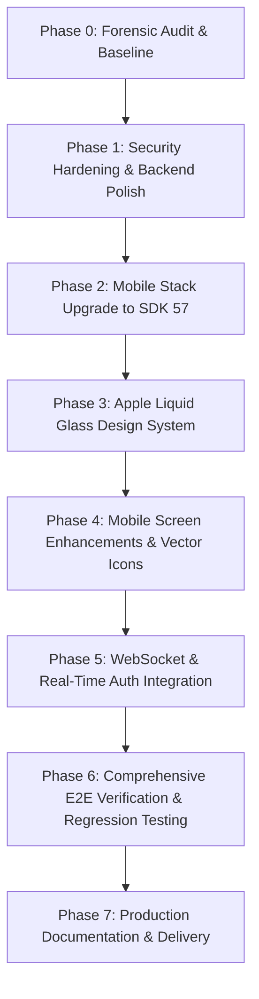

# FORENSIC AUDIT & IMPLEMENTATION ROADMAP
**Project:** Reinforcement-Learning-Based Multi-Hazard Evacuation Routing Platform  
**Audit Date:** 2026-10-19  
**Branch:** `production-upgrade`  
**Auditor:** Principal Architect & Production Engineering Agent  

---

## 1. Executive Summary & Forensic Baseline

A forensic audit of the repository located at `C:\Users\venka\OneDrive\Desktop\FinalYear` was conducted prior to code modifications. The repository contains a reinforcement learning evacuation platform coupling an **Offline-to-Online Multi-Agent Reinforcement Learning (MARL)** engine with an **OpenStreetMap (OSM)** road network, **Cellular Automata (CA)** flood/fire hazard engines, a **SUMO/TraCI** traffic simulation interface with macroscopic digital-twin fallback, a **FastAPI** backend, **PostgreSQL** persistence, and an **Expo React Native** mobile application.

### Baseline Metrics Verified:
- **FastAPI Backend:** Fully structured with layered services, routers, Pydantic schemas, and SQLAlchemy models.
- **Automated Tests:** 35/35 pytest tests currently pass in the Python 3.11 environment.
- **Offline-to-Online MARL Checkpoint:** `models/marl_six/offline_online/seed_42/best_model.pt` verified with **327,204 parameters**, 34-dimensional observation space, and hard action masking.
- **Spatial Road Graph:** 336 nodes and 736 edges loaded from `data/processed/road_graph_large.json`. Max distance: 8,433.6m.
- **PostgreSQL Database:** Running native PostgreSQL 18.6 on port 5432 with database `evacuation_db`. All 9 core relational tables initialized and validated.
- **Mobile Stack:** Expo SDK 52 with TypeScript compilation passing (0 errors) and `expo-doctor` passing 18/18 checks on the SDK 52 baseline.
- **Live Evacuation Workflow:** Genuine multi-agent node-by-node movement, distance/time progression, dynamic rerouting on hazard changes, WebSocket broadcasting, and PostgreSQL history persistence verified via `test_live_simulation_and_movement.py`.

---

## 2. Dependency Audit & Technology Versions

### 2.1 Backend & Machine Learning Stack
| Component | Existing Version | Target / Audited Version | Status |
| :--- | :--- | :--- | :--- |
| **Python** | 3.11.15 | 3.11.15 (uv managed) | Stable & Verified |
| **PyTorch** | 2.5.1+cu124 | 2.5.1+cu124 | CUDA active; verified inference |
| **FastAPI** | 0.115.6 | 0.115.6 | Operational |
| **SQLAlchemy** | 2.0.36 | 2.0.36 | Operational |
| **PostgreSQL** | 18.6 (Local) / 16 (Docker) | PostgreSQL 18.6 on port 5432 | Connected & verified |
| **NetworkX** | 3.4.2 | 3.4.2 | Operational |
| **SUMO / TraCI** | 1.21.0 | SUMO 1.21.0 (Digital Twin active) | Truthful fallback active |

### 2.2 Mobile Application Stack
| Dependency | Existing Version | Target Compatibility | Upgrade Risk / Action |
| :--- | :--- | :--- | :--- |
| **Expo SDK** | ~52.0.0 | **SDK 57 (Target) / SDK 58 (Latest)** | Breaking change: React Native 0.76 -> 0.86, React 18.3 -> 19.2 |
| **React** | 18.3.1 | 19.2.x | Requires dependency alignment |
| **React Native** | 0.76.9 | 0.86.x | Requires compatibility review |
| **@react-navigation** | ^7.2.0 | ^7.x | Compatible with Expo SDK 57/58 |
| **expo-secure-store** | ~14.0.0 | ~15.x / aligned | Compatible |
| **expo-location** | ~18.0.0 | ~19.x / aligned | Compatible |
| **react-native-svg** | 15.8.0 | Aligned with target SDK | Compatible |
| **zustand** | ^5.0.3 | ^5.0.3 | Fully compatible |

---

## 3. Prioritized Audit Findings

Findings are classified according to engineering severity:
- **P0**: Security vulnerability, data corruption, or critical execution failure.
- **P1**: Core product workflow failure or compatibility mismatch.
- **P2**: Important usability, reliability, or performance defect.
- **P3**: Polish and optional improvements.

---

### Finding P0-1: Insecure WebSocket Telemetry Endpoint (Authentication & Authorization Bypass)
- **Location:** `backend/app/main.py:148-162`, `backend/app/websocket/manager.py:14-32`
- **Description:** The WebSocket endpoint `/ws/evacuation/{session_id}` does not authenticate the connecting client. Any client knowing or brute-forcing a `session_id` can connect, receive live spatial telemetry, agent locations, and route updates. Furthermore, there is no cross-user session isolation check to ensure that the user subscribing to `session_id` owns the session or has permissions.
- **Remediation:**
  1. Add token verification on WebSocket connection (extract JWT bearer token from query parameters `?token=...` or headers).
  2. Verify that the authenticated user owns the session or has `ADMIN`/`RESEARCHER` privileges.
  3. Close unauthorized connections with code 4401 (`UNAUTHORIZED`) or 4403 (`FORBIDDEN`).

---

### Finding P0-2: Insecure & Invalid CORS Configuration
- **Location:** `backend/app/main.py:68-74`, `backend/app/core/config.py:48-56`
- **Description:** `main.py` adds `CORSMiddleware` with `allow_origins=settings.CORS_ORIGINS` where `CORS_ORIGINS` defaults to `["*"]`, while `allow_credentials=True`. According to the W3C CORS specification and Starlette implementation, wildcard `*` with credentials is rejected by modern browsers and constitutes an insecure origin policy.
- **Remediation:**
  1. Explicitly enumerate allowed origins for development (e.g. `http://localhost:8081`, `http://localhost:19006`, `http://10.0.2.2:8081`).
  2. Disallow `*` whenever `allow_credentials=True`.
  3. Support environment-configured explicit origins for production.

---

### Finding P1-1: Expo Go Version Incompatibility (SDK 52 vs SDK 57 Client)
- **Location:** `mobile/package.json:17`, `mobile/app.json`
- **Description:** The mobile application is configured for Expo SDK 52. When testing on physical devices or Android emulators running the latest Expo Go client (SDK 57), Expo Go rejects the project with a version mismatch error ("Project requires SDK 52, but Expo Go is SDK 57").
- **Remediation:**
  1. Create upgrade checkpoint branch.
  2. Upgrade Expo dependencies to SDK 57 using `npx expo install expo@~57.0.0 --fix`.
  3. Resolve React 19 / React Native 0.86 peer dependency adjustments.
  4. Verify TypeScript compilation (`tsc --noEmit`) and `expo-doctor`.
  5. Provide standalone Android development build configurations (`expo prebuild`) as an independent alternative to Expo Go sandbox.

---

### Finding P1-2: PyTorch Insecure Deserialization (`weights_only=False` Warning)
- **Location:** `src/agents/marl_six/offline_online_agent.py:358`, `backend/app/ml/model_manager.py:85`
- **Description:** Model loading invokes `torch.load(filepath, map_location=self.device)` without `weights_only=True`, emitting a `FutureWarning` and exposing the server to arbitrary code execution if a checkpoint is compromised.
- **Remediation:**
  1. Audit checkpoint files (`best_model.pt` contains state dictionaries).
  2. Specify `weights_only=True` in `torch.load` calls across all model managers and benchmark agents where feasible, or safely restrict globals.

---

### Finding P1-3: Mobile WebSocket Client Missing Auth Parameter
- **Location:** `mobile/src/store/evacuationStore.ts:135`
- **Description:** `evacuationStore.ts` initiates WebSocket connections as `new WebSocket('${WS_BASE_URL}/ws/evacuation/${sessionId}')` without attaching the user's JWT access token. Once WebSocket security is applied on the backend, mobile clients will be rejected.
- **Remediation:**
  1. Fetch `token` from `useAuthStore` or `SecureStore`.
  2. Attach `?token=${token}` to the WebSocket URI.
  3. Handle authentication failures gracefully in WebSocket lifecycle.

---

### Finding P2-1: Lack of Apple Liquid Glass-Inspired Design System
- **Location:** `mobile/src/theme/colors.ts`, `mobile/src/components/`, `mobile/src/screens/`
- **Description:** The current UI uses flat dark navy containers (`#080C16`, `#111827`) with standard borders and emoji icons in navigation (`HomeScreen`, `TabNavigator`). It lacks translucent glass surfaces, specular refraction borders, layered depth hierarchy, fluid transitions, and a centralized glass component library.
- **Remediation:**
  1. Create a centralized Liquid Glass Design System (`mobile/src/theme/liquidGlass.ts`).
  2. Implement reusable `GlassCard`, `GlassHeader`, `GlassTabBar`, `GlassPill`, and `GlassModal` components with blur fallbacks for Android.
  3. Replace emoji navigation with professional `@expo/vector-icons` (Ionicons / MaterialCommunityIcons).

---

### Finding P2-2: Missing Rate Limiting on Expensive Endpoints
- **Location:** `backend/app/api/routes/auth.py`, `backend/app/api/routes/routes.py`, `backend/app/api/routes/evacuation.py`
- **Description:** High-cost operations such as MARL route calculation (`/routes/calculate`), evacuation session startup (`/evacuation/start`), and dynamic reroute triggers (`/evacuation/{id}/reroute`) have no rate limiting, leaving the server vulnerable to denial of service.
- **Remediation:**
  1. Implement an in-memory / token-bucket rate limiter dependency for sensitive auth and simulation endpoints.
  2. Return HTTP 429 (`Too Many Requests`) with clear retry headers.

---

### Finding P2-3: Token Type Enforcement (Access vs. Refresh Token Distinction)
- **Location:** `backend/app/core/security.py:41-47`, `backend/app/api/deps.py:20-35`
- **Description:** `decode_token` accepts any token signed with `JWT_SECRET` without asserting `payload.get("type") == "access"`. If an attacker obtains a refresh token (or if token structures overlap), it could inadvertently authenticate API routes.
- **Remediation:**
  1. Enforce `payload.get("type") == "access"` in `deps.get_current_user`.
  2. Enforce `payload.get("type") == "refresh"` in `/auth/refresh`.

---

### Finding P2-4: Starlette TestClient / Httpx Deprecation Warning
- **Location:** `tests/test_backend_api.py:2`, `tests/test_live_simulation_and_movement.py:27`
- **Description:** Using `starlette.testclient.TestClient` with older `httpx` triggers a `StarletteDeprecationWarning`.
- **Remediation:** Clean up test imports and fixtures to eliminate deprecation noise.

---

### Finding P3-1: Mobile Accessibility Enhancements
- **Location:** `mobile/src/screens/`
- **Description:** Map controls, emergency action buttons, and hazard toggles require comprehensive `accessibilityLabel`, `accessibilityRole`, and `accessibilityHint` props for screen-reader compliance.

---

## 4. Prioritized Implementation Plan

1. **Step 1: Backend Security Hardening** (P0-1, P0-2, P1-2, P2-2, P2-3)
   - Enforce WebSocket JWT authentication and session authorization in `manager.py` and `main.py`.
   - Correct CORS origins and credentials configuration.
   - Restrict token type checks (access vs refresh).
   - Implement rate limiting on sensitive routes.
   - Secure PyTorch model checkpoint loading with `weights_only=True`.

2. **Step 2: Mobile Stack Upgrade to Expo SDK 57** (P1-1)
   - Upgrade `mobile/package.json` to Expo SDK 57.
   - Run `npx expo install --fix` to align peer dependencies.
   - Verify TypeScript passes with 0 errors (`npx tsc --noEmit`).
   - Verify `expo-doctor` passes all checks.

3. **Step 3: Apple Liquid Glass Design System** (P2-1)
   - Create `mobile/src/theme/liquidGlass.ts` with design tokens (materials, highlights, blur, borders).
   - Create reusable glass components (`GlassCard`, `GlassTabBar`, `GlassPill`, `GlassBadge`).
   - Replace emoji navigation in `TabNavigator.tsx` with `@expo/vector-icons`.

4. **Step 4: End-to-End Connected Mobile Features**
   - Connect all screens to live backend data (Scenario Builder, Live Evacuation, Session Details, History, Settings).
   - Ensure WebSocket passing authenticated token.

5. **Step 5: Testing & Production Validation**
   - Run full 35-test pytest suite.
   - Run live simulation movement and rerouting tests.
   - Run black-box production validation script.
   - Run security attack matrix tests (auth bypass, unauthorized WebSocket, CORS, injection).

6. **Step 6: Final Documentation & Production Report**
   - Generate all documentation deliverables in `docs/`.
